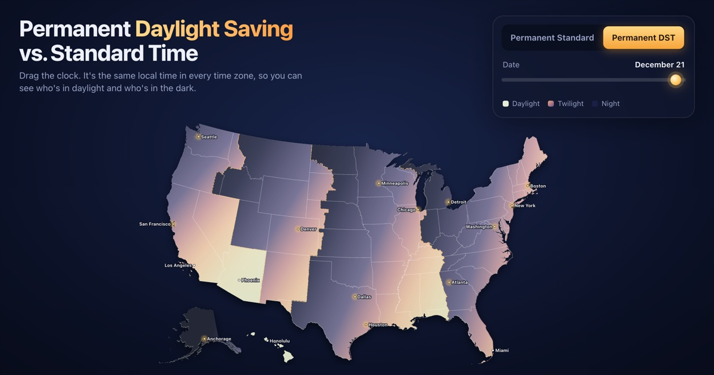

# Permanent DST vs. Standard Time

Interactive map of U.S. sunlight at the same local clock time in every time zone. Drag the clock, pick a date, and compare permanent Daylight Saving Time with permanent Standard Time.

**Live:** https://dstmap.us

Static files (`index.html`, plus `shade.js`, a worker that paints the overlay), no build step. Sun position uses NOAA's solar equations; map data is U.S. Census via [us-atlas](https://github.com/topojson/us-atlas). Time zones are assigned per county, and Arizona and Hawaii stay on standard time in both modes.

Run locally with any static server, e.g. `python3 -m http.server`.
